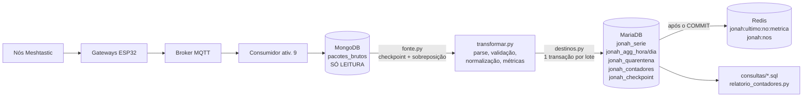

# Do pacote bruto ao dado útil: pipeline Meshtastic (Atividade 10)

Projeto Integrador de Big Data (IAL220, 2026.2), **Fatec Pompeia**.
Professor: **Allan Siriani** ([github.com/siriani](https://github.com/siriani) · [linkedin.com/in/siriani](https://linkedin.com/in/siriani)).
Aluno: Jonah Nishimura Kunihiro. Prefixo da disciplina: `jonah_*` (tabelas) e `jonah:*` (Redis).

## Objetivo

A rede LoRa em malha (Meshtastic) do campus e de Pompeia entrega pacotes ao MongoDB como chegam (coleção `pacotes_brutos`, atividade 9). Este pipeline **lê essa coleção sem alterá-la** e produz dado utilizável:

- **MariaDB**: série limpa (`jonah_serie`), agregados por hora e por dia, quarentena, lacunas, contadores e checkpoint;
- **Redis**: último valor de cada métrica de cada nó (`jonah:ultimo:<no>:<metrica>`);
- **Quarentena contável**: o que não passa na validação fica guardado com o motivo, nunca é descartado em silêncio.

## Arquitetura



Camadas (cada uma com uma responsabilidade):

| Arquivo | Papel |
|---|---|
| `pipeline/transformar.py` | **Puro, sem IO.** Parse, validação, normalização, extração de métricas, regras de relógio. Fácil de testar. |
| `pipeline/fonte.py` | Leitura do Mongo (`find` apenas), ordenada por `(recebido_em, _id)`. |
| `pipeline/destinos.py` | MariaDB e Redis. O dialeto SQL fica isolado em `_insert_ignore` e `_upsert` (MariaDB em produção, SQLite nos testes). |
| `pipeline/main.py` | Loop contínuo, reconexão, logs, desligamento limpo. |
| `schema/mariadb.sql` | DDL (InnoDB, índices). Executado na partida do pipeline. |

## Problemas tratados e como

| Problema | Tratamento |
|---|---|
| **Duplicatas** (o mesmo pacote chega por vários gateways) | Chave `(from, id)` em `jonah_pacotes_vistos` com `INSERT IGNORE`. **Nunca pelo conteúdo**: duas leituras com valores idênticos mas `id` diferente são medições distintas. A primeira cópia recebida fica; as demais vão para `jonah_duplicatas` e são contadas. |
| **Relógio errado do nó** | O tempo de referência é sempre `recebido_em`. O `timestamp` do nó vira só atributo (`instante_no`) e é marcado `instante_no_valido = 0` se ausente/0, anterior a 2024-01-01 ou posterior a `recebido_em + 5 min`. Cada caso é contado (`timestamp_invalido:ausente`, `:antes_2024`, `:futuro`). |
| **Lacunas** | Sem interpolação. A ausência é informação: a consulta 3 mostra silêncio atual e maior intervalo por nó, e `jonah_lacunas` registra cada intervalo maior que 2 × `INTERVALO_ESPERADO_MIN` (padrão 30 min, o mínimo de telemetria do firmware no canal público; ou seja, lacuna acima de 60 min). Pacote que chega tarde recalcula as lacunas vizinhas. |
| **Esquemas variáveis** | Separação por tipo (`telemetry` gera métricas; `position`, `nodeinfo`, `text`, `neighborinfo`, `traceroute` etc. são validados e contados como `sem_metrica`). Aceita `snake_case` e `camelCase` (`battery_level`/`batteryLevel`) e métricas aninhadas em `device_metrics`/`environment_metrics`. Cada valor é checado (numérico, finito, dentro de faixa física). |
| **Quarentena** | JSON inválido (`mensagem_raw`), `mensagem` ausente ou não objeto, `from`/`id`/`type` faltando, `type` desconhecido, payload ausente, valor não numérico, valor fora de faixa, telemetria sem nenhuma métrica conhecida. Vai para `jonah_quarentena` com `bruto_id`, `motivo`, `detalhe`, `recebido_em` e o documento original em JSON. Um pacote com qualquer campo inválido é rejeitado inteiro: não se grava metade de um pacote. |

## Garantias no reinício: por que é exatamente-uma-vez efetivo

Entregar "exatamente uma vez" de verdade entre dois sistemas é impossível; o que se faz é **leitura pelo menos uma vez + escrita idempotente**, cujo efeito observável é exatamente uma vez. Aqui:

1. **Nada se perde.** O checkpoint (`recebido_em` + `_id` do último documento) só avança **na mesma transação** que grava os dados daquele lote. Se o processo cai antes do `COMMIT`, o MariaDB desfaz o lote inteiro e o checkpoint fica onde estava; ao voltar, o lote é lido de novo. Além disso, a leitura recomeça em `checkpoint − SOBREPOSICAO_SEGUNDOS` (padrão 120 s), o que apanha documentos que entraram no Mongo com `recebido_em` ligeiramente atrasado (outro processo gravando, relógio do consumidor).
2. **Nada duplica.** Reler um documento é inofensivo porque todo efeito é protegido por uma chave única: pacote em `jonah_pacotes_vistos (no, pacote_id)`, linha da série em `(no, pacote_id, metrica)`, quarentena em `bruto_id`, cópia duplicada em `bruto_id`. O `INSERT IGNORE` não insere uma segunda vez.
3. **Os contadores não inflam.** Cada contador só é incrementado quando o `INSERT IGNORE` correspondente inseriu de fato (`rowcount = 1`), e isso acontece na mesma transação. Reler um documento já tratado dá `rowcount = 0` e não conta nada. Para distinguir "mesma cópia relida" de "cópia nova do mesmo pacote (duplicata real)", `jonah_pacotes_vistos` guarda o `bruto_id` da primeira cópia e cada cópia extra é registrada em `jonah_duplicatas` pelo próprio `bruto_id`.
4. **Agregados e lacunas** são recalculados *dentro da mesma transação*, a partir da série, só para as janelas/nós afetados pelos pacotes **novos** do lote. Recalcular do zero uma janela dá sempre o mesmo resultado (idempotente) e um upsert substitui a linha anterior.
5. **Redis é derivado e monotônico.** Só é atualizado depois do `COMMIT` e só se o `instante` for estritamente mais novo (`WATCH/MULTI/EXEC`), então reaplicar não muda nada e uma leitura antiga nunca sobrescreve uma nova. Se o processo cair entre o `COMMIT` e a escrita no Redis, na partida (e sempre que o Redis ficar indisponível) o pipeline **ressincroniza** o Redis a partir do último valor de cada `(no, metrica)` no MariaDB.

Limite honesto: um documento que chegue ao Mongo com `recebido_em` **mais antigo que o checkpoint menos a sobreposição** não é relido. Aumente `SOBREPOSICAO_SEGUNDOS` se o consumidor da ativ. 9 puder gravar com muito atraso. Documentos sem `recebido_em` do tipo data não são encontrados pela consulta de leitura.

## Como rodar

### Local (venv)

```powershell
python -m venv .venv
.\.venv\Scripts\activate
pip install -r requirements.txt
copy .env.example .env      # preencha com as credenciais reais (o .env está no .gitignore)
python -m pipeline.main            # loop contínuo
python -m pipeline.main --uma-vez  # processa o pendente e sai
```

Variáveis (`.env.example`): `MONGO_URI`, `MONGO_DB`, `MONGO_COLLECTION` (`pacotes_brutos`, contrato da ativ. 9; o esquema legado `sensores` da turma também é aceito), `FONTE_FORMATO`, `MARIADB_URL`, `REDIS_URL`, `PREFIXO=jonah`, `POLL_SEGUNDOS` (intervalo do polling), `LOTE`, `SOBREPOSICAO_SEGUNDOS`, `INTERVALO_ESPERADO_MIN`. O modo padrão é polling, o mais seguro: não depende de replica set (change streams exigem um).

### Formato da fonte (adaptador)

`pipeline/adaptador.py` normaliza a origem para o contrato interno, escolhido por `FONTE_FORMATO` (`auto` | `pacotes_brutos` | `legado`):

- `pacotes_brutos`: `{topico, recebido_em, mensagem | mensagem_raw}` (contrato da ativ. 9).
- `legado`: esquema do consumidor da turma em `iot.sensores`: `{topic, received_at, payload (string JSON), payload_data (objeto), data}`. O objeto Meshtastic vem de `payload_data`; se faltar, de `data` quando for objeto (documentos antigos, em que `data` não é data/hora); senão do parse da string `payload`; JSON inválido vira `json_invalido` e a ausência de tudo vira `mensagem_ausente` (quarentena). O horário de recebimento é `received_at`.
- `auto`: decide pelos campos (`recebido_em` ou `received_at`).

A quarentena guarda o documento **original** da fonte. O pipeline é só leitura na origem. As tabelas criadas são apenas as `jonah_*`; o banco de destino pode conter tabelas de outros alunos e elas não são tocadas.

Operação real: em 27/10/2026, das 13:50 às 22:12 (horário de Brasília, cerca de 8 h 20 min), o rádio `!8fa673bc` (Heltec V4) publicou telemetria de dispositivo a cada 30 min e o pipeline leu `iot.pacotes_brutos`. A coleta foi encerrada antes das 72 h do enunciado; os contadores e as consultas finais estão em `docs/operacao_real/relatorio_final_20261027_2212.txt` (19 pacotes processados, 85 medidas, conferência fechada). Com um único nó publicando, os casos de três ou mais nós e de nó por salto não aparecem nos dados reais. O checkpoint permanece gravado, então o pipeline retoma do ponto em que parou se o gateway voltar a publicar. Para exercitar todos os caminhos do código há uma **simulação acelerada de 72 h**, identificada como tal, em tabelas separadas (`jonahsim_*`): `ferramentas/simular_72h.py` e `docs/simulacao_72h/relatorio_simulacao.md`.

### Docker

```bash
docker build -t jonah-pipeline .
docker run -d --name jonah-pipeline --restart unless-stopped --env-file .env jonah-pipeline
docker logs -f jonah-pipeline
```

### 72 horas no servidor

```bash
docker run -d --name jonah-pipeline --restart unless-stopped --env-file .env jonah-pipeline
# anote a data/hora de início (docker inspect -f '{{.State.StartedAt}}' jonah-pipeline)
# durante as 72 h acompanhe: docker logs --tail 50 jonah-pipeline
# ao final:
docker exec jonah-pipeline python relatorio_contadores.py
docker exec jonah-pipeline python consultas/executar_consultas.py
docker stop jonah-pipeline    # desligamento limpo (SIGTERM): termina o lote atual e sai
```

`--restart unless-stopped` religa o container após queda do servidor; o checkpoint garante a retomada sem duplicar nem perder.

## Contadores

`python relatorio_contadores.py` imprime, a partir das tabelas: processados, válidos, duplicatas, timestamps inválidos (por motivo), quarentena (por motivo), pacotes sem métrica, medidas gravadas, linhas por tabela e uma conferência `validos + duplicatas + quarentena = processados`.

## Consultas

Em `consultas/` (compatíveis com MariaDB 10.6+); o runner imprime em tabela:

```bash
python consultas/executar_consultas.py      # as três
python consultas/executar_consultas.py 3    # só a de tempo de silêncio
```

1. `01_tensao_media_bateria_por_no_por_dia.sql`: tensão média (V) por nó por dia (UTC).
2. `02_utilizacao_canal_por_hora.sql`: `channel_utilization` por hora, média ponderada da rede.
3. `03_tempo_de_silencio_por_no.sql`: silêncio atual, maior intervalo e nº de lacunas por nó.

## Testes

```powershell
pip install -r requirements-dev.txt
python -m pytest -q
```

Rodam sem serviços reais (mongomock, fakeredis, SQLite): deduplicação entre gateways, relógio inválido, quarentena, reinício no meio do processamento, Redis sem regressão, agregados, lacunas e conferência entre o DDL e o modelo. **Limite dos testes:** o caminho específico do MariaDB (`INSERT IGNORE`, `ON DUPLICATE KEY UPDATE`, execução do DDL e a consulta 3 com `TIMESTAMPDIFF`/`LAG`) só roda contra um MariaDB real; valide-o no servidor antes das 72 h.

## Dados sintéticos

`ferramentas/semear_mongo_local.py` gera pacotes **falsos** num Mongo **local**, só para testar. Recusa hosts remotos, grava em banco próprio e marca os documentos com `_sintetico: true`. **Nunca use esses dados como evidência da entrega.**

## Documentação

- `docs/modelo_de_dados.md`: tabelas, chaves Redis e a justificativa de cada escolha.
- `docs/simulacao_72h/relatorio_simulacao.md`: contadores e consultas da simulação (dados gerados por programa, não são medição real).
- `docs/artigo_linkedin.md` e `docs/artigo/`: texto e figuras do artigo publicado no LinkedIn, [Do pacote bruto ao dado útil](https://www.linkedin.com/pulse/do-pacote-bruto-ao-dado-%C3%BAtil-jonah-nishimura-kunihiro-s5kmf/).

---
Atividade da disciplina Projeto Integrador de Big Data (IAL220), Fatec Pompeia, professor Allan Siriani.
