# Do pacote bruto ao dado útil

> Texto do artigo publicado no LinkedIn em 27/10/2026: [Do pacote bruto ao dado útil](https://www.linkedin.com/pulse/do-pacote-bruto-ao-dado-%C3%BAtil-jonah-nishimura-kunihiro-s5kmf/). Os números reais são um retrato de 27/10/2026 às 20:20 e serão atualizados ao fim da janela de 72 h (30/10/2026 às 13:50).

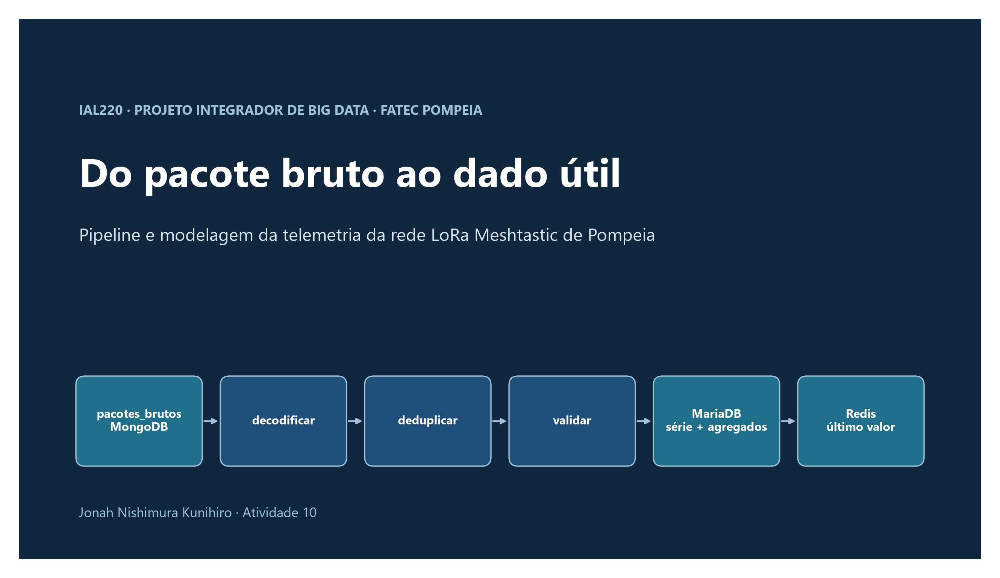

*Pipeline contínuo de decodificação, deduplicação, validação e agregação da telemetria da rede LoRa Meshtastic de Pompeia, com resultados da operação real e de uma simulação controlada de 72 horas.*

**Autor:** Jonah Nishimura Kunihiro

**Vínculo:** Fatec Pompeia, Projeto Integrador de Big Data (IAL220), Prof. Allan Siriani. Atividade 10, "Do pacote bruto ao dado útil: pipeline e modelagem".

**Repositório:** https://github.com/JonahKun/meshtastic-pipeline-ativ10

## Resumo

Este artigo apresenta um pipeline contínuo que lê os pacotes brutos da rede LoRa em malha Meshtastic armazenados no MongoDB e os converte em uma série temporal limpa e em agregados horários e diários no MariaDB, mantendo no Redis o último valor de cada nó e métrica. São tratados os quatro problemas do dado bruto definidos no enunciado: duplicatas, identificadas pelo par (nó de origem, id do pacote); relógios de nó incorretos, substituídos pelo instante de recebimento como referência temporal; lacunas, registradas como informação, sem interpolação; e esquemas variáveis, validados por tipo de pacote, com quarentena contável e motivada. A reinicialização segura combina leitura pelo menos uma vez com escrita idempotente e checkpoint gravado na mesma transação dos dados. Os resultados são apresentados em duas fontes mantidas separadas: a operação real, iniciada em 27/10/2026 às 13:50 e ainda em curso, com um nó publicando telemetria; e uma simulação de 72 horas, com pacotes gerados por programa e processados pelo próprio pipeline. Em ambas, a conferência entre contadores fecha sem divergência. A validação com três ou mais nós reais e com nó alcançado por salto ainda depende de dados que a rede não produziu.

**Palavras-chave:** Meshtastic; LoRa; pipeline de dados; deduplicação; MariaDB; Redis.

## 1 Introdução

O projeto da disciplina IAL220 é uma rede LoRa em malha, baseada no Meshtastic, que cobre o campus da Fatec e a cidade de Pompeia para coletar dados agrícolas. Desde a Atividade 9, os pacotes recebidos pelo gateway são persistidos sem transformação na coleção `pacotes_brutos` do MongoDB. Nesse estado, porém, eles ainda não respondem a nenhuma pergunta: chegam repetidos, com relógio incorreto, com intervalos sem leitura e, ocasionalmente, malformados.

A Atividade 10 exige um pipeline que transforme esse material em séries limpas, agregadas e consultáveis, com contadores que comprovem cada tratamento e três consultas sobre dados reais. Mesmo sem sensores agrícolas instalados, todo nó Meshtastic já emite telemetria do próprio dispositivo (tensão e nível da bateria, utilização do canal, tempo de ar e tempo ligado), o que constitui uma série temporal real, sujeita a todos os problemas de uma série real.

Este artigo descreve a arquitetura adotada (seção 2), o tratamento dos quatro problemas (seção 3), a garantia de reinício (seção 4), o modelo de dados e suas justificativas (seção 5), a execução contínua (seção 6) e os resultados (seção 7). Em todo o texto, os números da **operação real** e os da **simulação** são apresentados separadamente, pois têm pesos distintos como evidência. Os horários citados no texto estão no horário de Brasília; as tabelas das consultas mantêm o UTC devolvido pelo banco.

## 2 Arquitetura

O dado percorre a seguinte cadeia: nós Meshtastic, gateway (rádio `!8fa673bc`, Heltec V4), broker MQTT da disciplina, consumidor da Atividade 9, coleção `pacotes_brutos` no MongoDB (somente leitura), pipeline em Python e, por fim, três destinos. O gateway publica as mensagens no ramo JSON do tópico MQTT (MESHTASTIC, 2026). A Figura 1 resume o percurso.

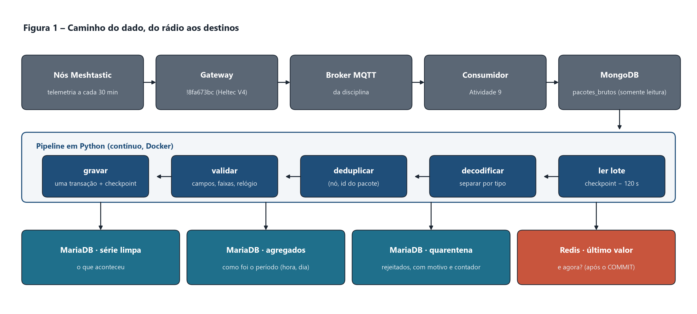

Os três destinos respondem a perguntas diferentes: a série limpa responde "o que aconteceu"; os agregados, "como foi o período"; e o Redis, "qual é o estado agora". A quarentena e os contadores tornam auditável aquilo que foi rejeitado.

O código está organizado em camadas com responsabilidade única. O módulo `transformar.py` é puro (sem entrada e saída) e concentra a decodificação, a validação e as regras de relógio; `fonte.py` apenas lê o MongoDB; `destinos.py` grava no MariaDB e no Redis; e `main.py` controla o laço contínuo, a reconexão e o desligamento limpo. Essa separação permite testar as regras sem serviços externos: a suíte de testes utiliza mongomock, fakeredis e SQLite, com a ressalva de que o caminho específico do MariaDB é exercido apenas no servidor.

## 3 Tratamento dos quatro problemas do dado bruto

A Tabela 1 relaciona cada problema ao tratamento implementado e ao contador que o mede.

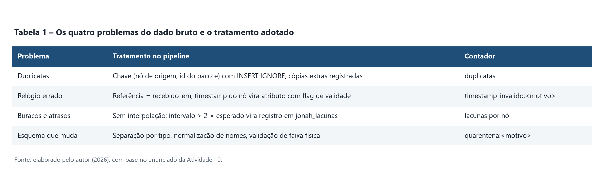

### 3.1 Duplicatas

O mesmo pacote pode chegar ao servidor por mais de um caminho na malha ou por mais de um gateway, com valores diferentes de `rssi`, `snr` e `hops_away`. Por isso, a deduplicação é feita pela identidade do pacote, o par (nó de origem, id do pacote), e nunca pelo conteúdo: duas leituras de tensão idênticas em instantes diferentes são medições distintas. A chave é aplicada com `INSERT IGNORE`; a primeira cópia é mantida e as demais são registradas na tabela de duplicatas, o que torna o contador exato e distingue uma duplicata real de uma simples releitura.

### 3.2 Relógio do nó

Nós sem GPS nem NTP enviam carimbos de tempo inválidos (zero, 1970 ou datas futuras). A referência temporal adotada é o instante de recebimento no servidor (`recebido_em`), único relógio confiável e monotônico da cadeia. O carimbo do nó é preservado como atributo (`instante_no`) com indicador de validade, sendo considerado inválido quando ausente ou nulo, anterior a 2024 ou mais de 5 minutos à frente do recebimento. Cada motivo possui contador próprio.

### 3.3 Lacunas e atrasos

A ausência de leitura é tratada como informação e não é preenchida por interpolação. Cada intervalo entre pacotes consecutivos de um nó que exceda duas vezes o intervalo esperado é registrado na tabela `jonah_lacunas`, recalculada ao redor de pacotes que chegam com atraso. Com a telemetria configurada a cada 30 minutos, o limite de lacuna é de 60 minutos.

### 3.4 Esquema variável

Pacotes de telemetria, posição, cadastro do nó (`nodeinfo`) e texto possuem campos diferentes, e versões de firmware alteram nomes (por exemplo, `batteryLevel` e `battery_level`). O pipeline separa os pacotes por tipo, normaliza os nomes das métricas e valida campos obrigatórios e faixas físicas. JSON inválido, campo obrigatório ausente, tipo desconhecido e valor fora da faixa são enviados à quarentena com motivo, detalhe e documento original. Um pacote com qualquer campo inválido é rejeitado integralmente, de modo que nunca se grava parte de um pacote.

## 4 Reinício sem perda nem duplicação

A entrega "exatamente uma vez" entre dois sistemas distribuídos não é garantida na prática. O pipeline obtém o mesmo efeito observável combinando leitura pelo menos uma vez com escrita idempotente:

- O checkpoint (`recebido_em` e `_id` do último documento processado) avança **na mesma transação** que grava o lote. Se o processo for interrompido antes do `COMMIT`, o lote inteiro é desfeito e relido.
- A leitura recomeça 120 segundos antes do checkpoint, para alcançar documentos gravados com atraso no MongoDB.
- A releitura é inofensiva, pois toda escrita possui chave única, e os contadores só são incrementados quando o `INSERT IGNORE` efetivamente insere uma linha.
- O Redis é tratado como dado derivado: é atualizado somente após o `COMMIT` e apenas se o instante for mais recente que o armazenado, por meio de `WATCH`, `MULTI` e `EXEC` (REDIS, 2026). Em caso de perda, é reconstruído a partir do MariaDB.

O limite conhecido desse desenho é que um documento inserido no MongoDB com `recebido_em` anterior ao checkpoint menos a janela de sobreposição não é relido.

## 5 Modelo de dados

Todas as tabelas utilizam o mecanismo InnoDB, necessário às transações, e o prefixo `jonah_` exigido pela disciplina. As datas são armazenadas em UTC. As Tabelas 2 e 3 apresentam o esquema; o DDL completo está em `schema/mariadb.sql` e a documentação, em `docs/modelo_de_dados.md` (KUNIHIRO, 2026b).

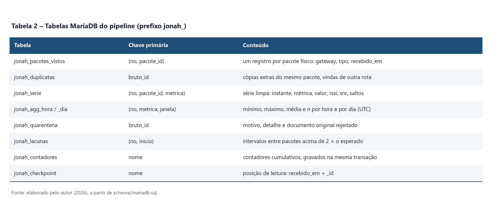

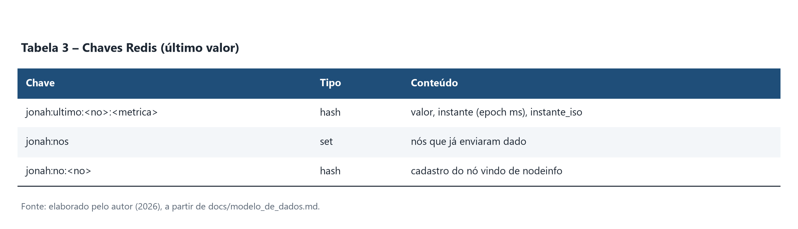

### 5.1 Por que a métrica é linha e não coluna

A série foi modelada no formato longo, com uma linha por (nó, pacote, métrica). Os tipos de telemetria variam conforme o firmware e os sensores, e os sensores agrícolas do projeto ainda serão instalados. Uma tabela larga exigiria `ALTER TABLE` a cada métrica nova; no formato longo, uma métrica nova é apenas um novo valor na coluna `metrica`. A chave primária (no, pacote_id, metrica) torna a gravação idempotente, e os índices (no, metrica, instante) e (metrica, instante) atendem, respectivamente, às consultas de um nó e às da rede inteira por período.

### 5.2 Por que agregar por hora e por dia, e não por 15 minutos

No canal público, o firmware aceita telemetria a cada 30 minutos, no mínimo. Uma janela de 15 minutos conteria no máximo uma leitura por nó, de modo que o "agregado" seria a própria leitura bruta, e metade das janelas ficaria vazia. A janela horária reúne cerca de duas leituras por nó e produz 24 pontos por dia, resolução suficiente para observar o ciclo diário de ocupação do canal (Figura 4). A janela diária atende à pergunta sobre a bateria, isto é, se a tensão sobe durante o dia e cai à noite em um nó solar. Os agregados (mínimo, máximo, média e n) são recalculados apenas para as janelas afetadas por cada lote, o que os torna idempotentes e corretos mesmo com dados tardios; guardar `n` permite combinar médias com peso, como faz a consulta 2.

### 5.3 Por que Redis para o último valor, e não uma consulta no MariaDB

Obter o último valor de cada nó e métrica no MariaDB exige agrupar e ordenar uma série que cresce continuamente, a cada leitura do painel ou verificação de alerta. No Redis, a mesma resposta é uma leitura de chave em tempo constante, adequada ao painel e aos alertas da Atividade 11. A atualização condicional impede que um pacote antigo, entregue com atraso, sobrescreva um valor mais novo. Como o MariaDB permanece a fonte da verdade, o Redis pode ser perdido e reconstruído sem prejuízo.

### 5.4 Quarentena e contadores na mesma transação

Nenhum documento é descartado silenciosamente. Cada rejeição é armazenada com motivo categórico (contável com `GROUP BY motivo`), detalhe legível e documento original, o que permite reprocessá-la após a correção de uma regra. Os contadores são gravados na mesma transação dos dados, o que garante a invariante **processados = válidos + duplicatas + quarentena** mesmo após uma queda.

## 6 Execução contínua

O pipeline é empacotado em um `Dockerfile` e executado como processo contínuo (`docker run --restart unless-stopped --env-file .env`). As credenciais ficam apenas no arquivo `.env`, ignorado pelo Git, e o arquivo `.env.example` documenta o formato. O modo padrão de leitura é por consulta periódica (polling), que não depende de replica set no MongoDB. O repositório inclui ainda o script `relatorio_contadores.py`, que gera o relatório final dos contadores, e `consultas/executar_consultas.py`, que executa as três consultas.

## 7 Resultados

### 7.1 Contadores

A operação contínua real teve início em **27/10/2026 às 13:50**, quando o rádio `!8fa673bc` passou a operar como gateway. A janela de 72 horas reais termina em **30/10/2026 às 13:50**, e os números finais serão atualizados ao seu término. Os valores reais da Tabela 4 correspondem ao retrato de 27/10/2026 às 20:20, após cerca de 6 horas e 30 minutos de operação. Ao lado, constam os contadores da simulação, descrita na seção 7.5.

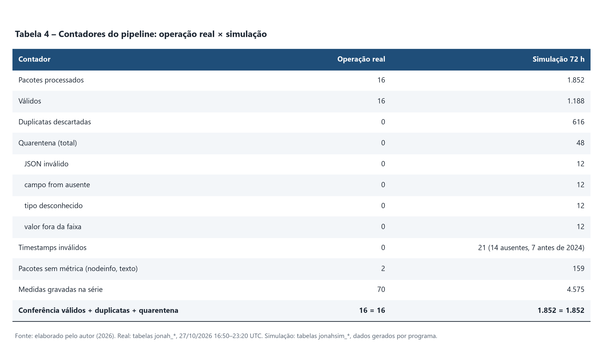

Nas duas fontes, a conferência fecha: 16 + 0 + 0 = 16 na operação real e 1.188 + 616 + 48 = 1.852 na simulação. Na operação real, os contadores de duplicatas e de quarentena zerados refletem uma amostra pequena, com um único nó, e não constituem prova de que esses casos não ocorrerão. Na simulação, os defeitos foram injetados de propósito em quantidades iguais (12 por motivo de quarentena), o que demonstra que cada tipo de falha é detectado e contado, mas não descreve o comportamento da rede real.

### 7.2 Consulta 1: tensão média da bateria por nó e por dia

A consulta lê o agregado diário e responde se um nó solar está carregando.

```sql
SELECT no, DATE(janela) AS dia,
       ROUND(media, 3) AS tensao_media_v,
       ROUND(minimo, 3) AS tensao_min_v,
       ROUND(maximo, 3) AS tensao_max_v,
       n AS leituras
FROM jonah_agg_dia
WHERE metrica = 'voltage'
ORDER BY dia DESC, no;
```

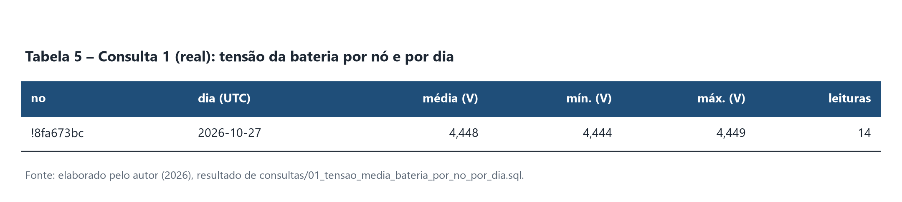

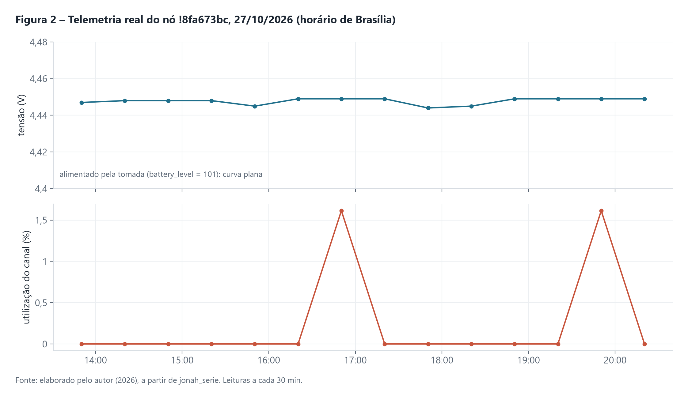

O nó `!8fa673bc` registrou média de 4,448 V, com variação de apenas 0,005 V em 14 leituras. O valor `battery_level` igual a 101 indica alimentação externa: o rádio está ligado à tomada, e a curva plana é o resultado esperado.

### 7.3 Consulta 2: utilização do canal por hora

A consulta responde se a malha está saturando. A média da rede é ponderada pelo número de leituras de cada nó.

```sql
SELECT janela AS hora_utc,
       COUNT(DISTINCT no) AS nos_com_dados,
       ROUND(SUM(media * n) / SUM(n), 2) AS utilizacao_media_pct,
       ROUND(MAX(maximo), 2) AS utilizacao_max_pct,
       SUM(n) AS leituras
FROM jonah_agg_hora
WHERE metrica = 'channel_utilization'
GROUP BY janela
ORDER BY janela DESC;
```

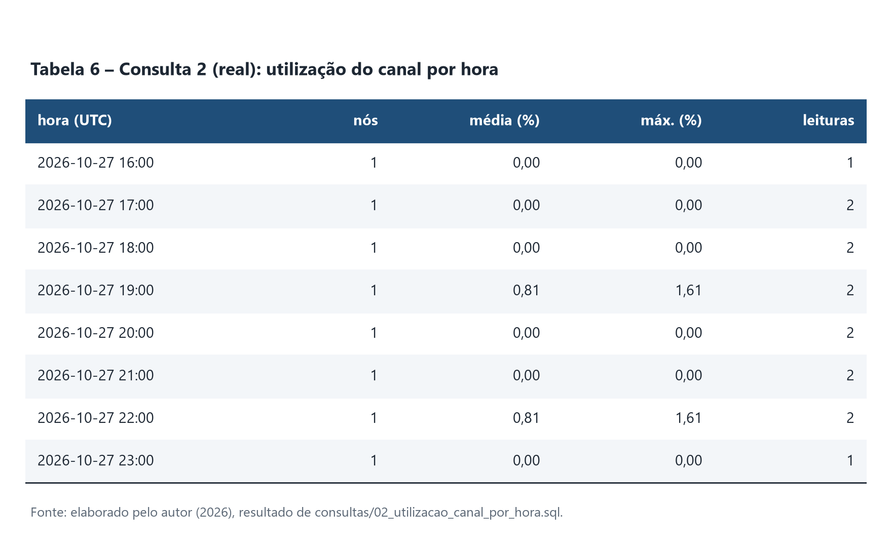

Com um único nó transmitindo, a utilização do canal variou entre 0% e 1,61% por hora, valor muito distante de qualquer risco de saturação.

### 7.4 Consulta 3: tempo de silêncio por nó

A consulta responde quais nós estão caindo. Ela usa a função de janela `LAG` para obter o pacote anterior de cada nó (MARIADB, 2026) e cruza o resultado com a tabela de lacunas.

```sql
WITH intervalos AS (
  SELECT no, recebido_em,
         TIMESTAMPDIFF(SECOND,
           LAG(recebido_em) OVER (PARTITION BY no ORDER BY recebido_em),
           recebido_em) AS intervalo_s
  FROM jonah_pacotes_vistos
)
SELECT i.no, COUNT(*) AS pacotes,
       MAX(i.recebido_em) AS ultimo_pacote_utc,
       ROUND(TIMESTAMPDIFF(SECOND, MAX(i.recebido_em), UTC_TIMESTAMP()) / 60, 1) AS silencio_atual_min,
       ROUND(MAX(i.intervalo_s) / 60, 1) AS maior_intervalo_min,
       (SELECT COUNT(*) FROM jonah_lacunas l WHERE l.no = i.no) AS lacunas
FROM intervalos i
GROUP BY i.no
ORDER BY silencio_atual_min DESC;
```

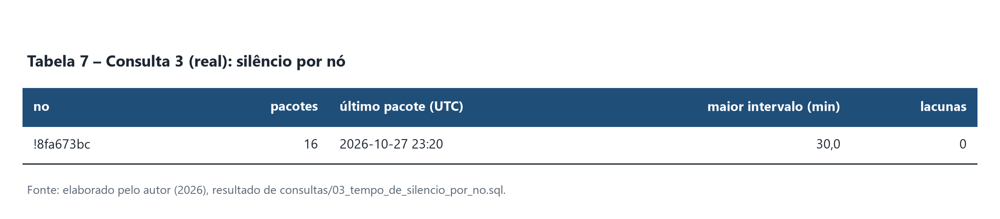

O maior intervalo observado foi de 30,0 minutos, igual ao período configurado de telemetria, sem nenhuma lacuna registrada.

### 7.5 Simulação controlada de 72 horas

Para exercitar todos os caminhos do código antes do fim da janela real, foi realizada uma simulação. **Nenhum número desta seção corresponde a medição real.** Os pacotes foram gerados pelo programa `ferramentas/simular_72h.py` (semente 42), com seis nós, duplicatas, defeitos de esquema e relógios inválidos, e foram processados pelo pipeline real, gravando em tabelas separadas (`jonahsim_*`), sem interferir nas tabelas da operação real (`jonah_*`). A janela simulada vai de 24/10 22:17 a 27/10 22:17 (UTC).

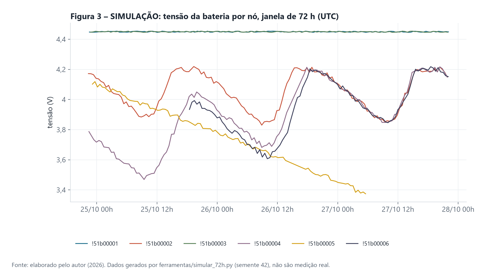

Na Figura 3, os nós `!51b00001` e `!51b00003` permanecem em torno de 4,45 V, comportamento de nós alimentados externamente; os nós com bateria apresentam ciclo de carga e descarga; e o nó `!51b00005` descarrega de forma contínua até 3,37 V e deixa de transmitir, situação que a consulta 3 deve evidenciar.

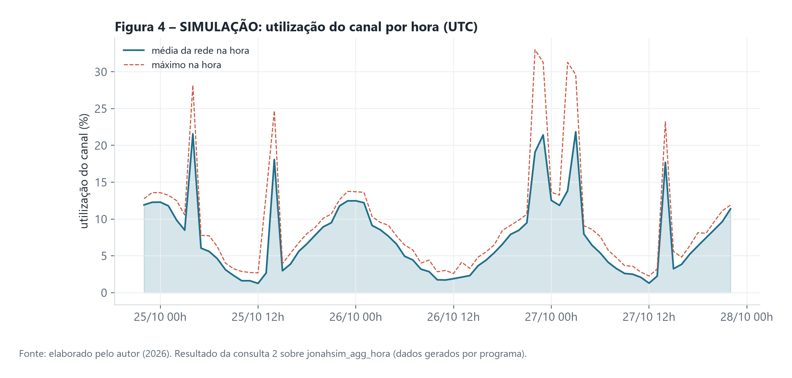

A Figura 4 mostra o ciclo diário da ocupação do canal, com médias de 1% a 2% perto do meio-dia e de 12% a 13% à noite, além de rajadas com médias acima de 20% e máximos de até 33%. Esse é o padrão que a agregação horária precisa tornar visível.

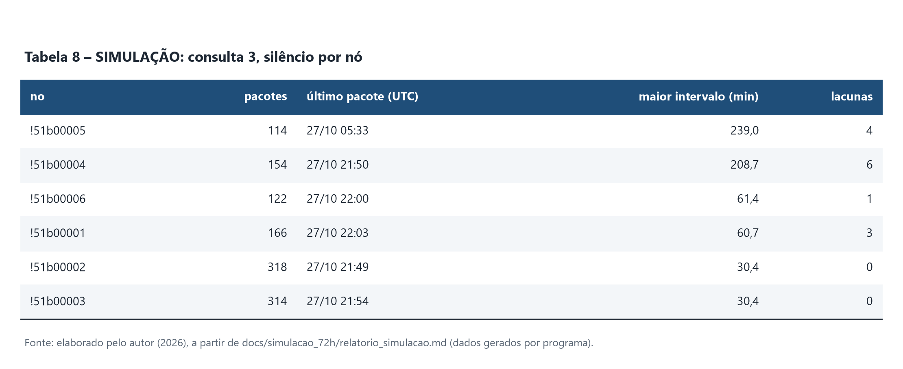

Na Tabela 8, o nó `!51b00005` aparece com maior intervalo de 239,0 minutos, 4 lacunas e último pacote às 05:33 (UTC) de 27/10, o que confirma a queda observada na Figura 3. O nó `!51b00004` soma 6 lacunas. A coluna de silêncio atual foi omitida porque mede o tempo até o instante em que a consulta foi executada, cerca de 50 minutos após o fim da janela simulada, e por isso não representa o comportamento simulado.

## 8 Ocorrências na operação e limitações

- **Gateway da turma fora do ar.** O gateway `!8fa724e8` deixou de publicar em 26/10 às 09:23. O consumidor permaneceu 18 horas e 30 minutos em execução sem receber mensagens (1.110 sinais de vida com `recebidas=0`). A verificação do último documento da fonte permitiu distinguir falha do consumidor de interrupção da fonte.
- **Desligamento acidental do computador.** Por volta das 13:00 de 27/10, o computador que executava os processos foi desligado acidentalmente, interrompendo a contagem contínua. Os processos foram religados às 13:18, e a ocorrência foi registrada.
- **Perda de conexão com o MariaDB.** Às 06:01 de 27/10, o pipeline perdeu a conexão com o banco. O erro foi registrado, a operação foi repetida e o processo se recuperou sem perder nem duplicar dados, comportamento previsto na seção 4.
- **Reconfiguração do rádio como gateway.** Para que o rádio `!8fa673bc` passasse a operar como gateway, o servidor MQTT, antes apontado para a Mesh Brasil, foi substituído pelo broker da disciplina, via Wi-Fi. O firmware só aceitou a alteração com o Wi-Fi já ativo e exigiu a gravação das demais opções de MQTT uma a uma.
- **Intervalo esperado ajustado.** O pipeline iniciou configurado para telemetria a cada 15 minutos (limite de lacuna de 30 minutos), mas o firmware aceita no mínimo 30 minutos no canal público, o que geraria lacunas falsas. O parâmetro foi corrigido para 30 minutos (limite de 60 minutos), e o pipeline foi reiniciado às 20:13 de 27/10, antes do surgimento de qualquer lacuna, retomando a partir do checkpoint.
- **Limitação dos dados reais.** Apenas um nó real publica telemetria. Os requisitos de três ou mais nós e de nó alcançado somente por salto ainda não aparecem nos dados reais.

## 9 Considerações finais

O pipeline atende ao que o enunciado propõe: deduplica por identidade, adota o instante de recebimento como referência temporal, registra lacunas sem interpolar, isola o que é inválido com motivo e mantém a conferência dos contadores, tanto na simulação quanto na operação real. As decisões de modelagem (série longa, agregação por hora e por dia e Redis como cache derivado do último valor) foram tomadas em função do intervalo real de telemetria e das perguntas que o painel e os alertas da próxima atividade precisarão responder. O que ainda falta é volume de dado real: a janela de 72 horas termina em 30/10/2026 às 13:50, e a validação com três nós e com nó alcançado por salto depende de a rede produzi-los. Os números serão atualizados ao fim da janela.

## Referências

KUNIHIRO, Jonah Nishimura. **meshtastic-consumidor-ativ09**: consumidor MQTT para MongoDB para gateway Meshtastic. GitHub, 2026a. Disponível em: https://github.com/JonahKun/meshtastic-consumidor-ativ09. Acesso em: 27 out. 2026.

KUNIHIRO, Jonah Nishimura. **meshtastic-pipeline-ativ10**: pipeline contínuo de pacotes_brutos (MongoDB) para MariaDB e Redis. GitHub, 2026b. Disponível em: https://github.com/JonahKun/meshtastic-pipeline-ativ10. Acesso em: 27 out. 2026.

MARIADB. **LAG**. MariaDB Knowledge Base, 2026. Disponível em: https://mariadb.com/kb/en/lag/. Acesso em: 27 out. 2026.

MESHTASTIC. **MQTT**: integrations overview. Meshtastic Documentation, 2026. Disponível em: https://meshtastic.org/docs/software/integrations/mqtt/. Acesso em: 27 out. 2026.

REDIS. **Transactions**. Redis Documentation, 2026. Disponível em: https://redis.io/docs/latest/develop/using-commands/transactions/. Acesso em: 27 out. 2026.

SIRIANI, Allan. **Do pacote bruto ao dado útil**: pipeline e modelagem. IAL220, Projeto Integrador de Big Data, Fatec Pompeia, 2026. Disponível em: https://lapps.studio/disciplinas/projeto-integrador-big-data/atividades/pipeline-bruto-ao-dado-util/. Acesso em: 27 out. 2026.
